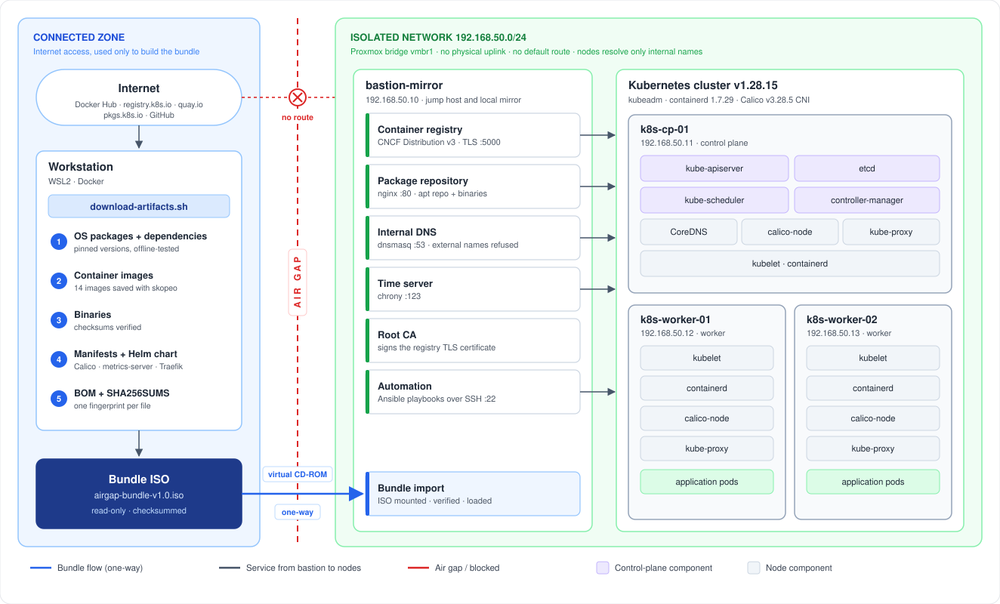

# Air-Gapped Kubernetes Cluster (PoC)

A multi-node Kubernetes cluster built and operated inside an isolated network with **no internet access**.
Every OS package, container image and binary is collected on a connected workstation, carried in on a
single ISO, and served to the cluster from a local bastion host.

- **Topology:** 1 bastion, 1 control plane, 2 workers (Ubuntu 22.04 VMs on Proxmox VE)
- **Network:** isolated bridge, no uplink, no default route
- **Delivery:** one checksummed ISO is the only way artifacts enter
- **Bootstrap:** kubeadm, with every image pulled from the local registry
- **Status:** all five acceptance tests passed

## Architecture



The cluster has two zones separated by an air gap:

- **Connected zone:** a workstation downloads and verifies everything the cluster needs and packs it into a bundle ISO.
- **Isolated network:** the ISO is attached to the bastion as a read-only virtual CD-ROM. The bastion then serves the cluster
  as its container registry, package repository, DNS server, time source and certificate authority, and configures the nodes with Ansible.
  No machine in this network has a route to the internet.

## How it was built

### 1. Artifact harvesting (connected workstation)

[`workstation/download-artifacts.sh`](workstation/download-artifacts.sh) runs the entire harvest in one command:

| Step | What it does |
| --- | --- |
| OS packages | Resolves the full dependency tree of containerd, kubeadm, kubelet, kubectl and the bastion services inside a clean Ubuntu 22.04 container, with versions pinned. It then proves the set is complete by installing it in a container with no network. |
| Container images | Saves all 14 required images (kubeadm, Calico, CoreDNS, metrics-server, Traefik, nginx, busybox) as tarballs with skopeo. |
| Binaries | Downloads the CNI plugins, crictl, Helm and the registry, and verifies each one against its published checksum. |
| Manifests | Calico, metrics-server and the Traefik Helm chart. |
| Packaging | Generates a bill of materials and a SHA256 checksum for every file, then builds the ISO. |

### 2. Transfer

The ISO is attached to `bastion-mirror` as a virtual CD-ROM and mounted read-only. Its checksums are verified before anything is used.

### 3. Local services on the bastion

| Service | Implementation | Purpose |
| --- | --- | --- |
| Container registry | CNCF Distribution v3, TLS on port 5000 | Serves all images and the Helm chart (OCI) as `bastion-mirror:5000/<project>/<image>` |
| Package repository | nginx on port 80 | apt repository and binaries for the nodes |
| Internal DNS | dnsmasq | Resolves lab hostnames and refuses every external name |
| Time server | chrony | Keeps all node clocks in sync, which certificate validation depends on |
| Root CA | OpenSSL | Issues the registry's TLS certificate. Nodes trust the CA, never the internet |

### 4. Node preparation (Ansible)

[`ansible/site.yml`](ansible/site.yml) configures all three nodes from the bastion and is idempotent: a second run reports zero changes.

- apt points only at the bastion repository, and services that contact the internet are removed (snapd, auto-updates, motd-news).
- Swap is disabled, the kernel modules (`overlay`, `br_netfilter`) and sysctl settings are applied, and the local CA is trusted.
- containerd, kubelet, kubeadm and kubectl are installed and their versions held.
- containerd uses systemd cgroups, pulls the pause image from the bastion, and redirects `docker.io`, `quay.io` and `registry.k8s.io` to the local registry.

### 5. Cluster bootstrap

- [`kubernetes/kubeadm-config.yaml`](kubernetes/kubeadm-config.yaml) sets `imageRepository: bastion-mirror:5000/k8s`, so `kubeadm init` pulls nothing from the internet.
- [`kubernetes/calico.yaml`](kubernetes/calico.yaml) has every image reference swapped to the local registry and uses the pod network `10.244.0.0/16`, kept separate from the node network.
- The workers join with the token and CA hash printed by `kubeadm init`.

### 6. Security hardening

| Control | Implementation |
| --- | --- |
| Registry TLS | Certificate signed by the local Root CA, trusted by every node |
| Pod Security Admission | `restricted` on the demo namespace, `baseline` (warn `restricted`) on `default`, `privileged` only on `kube-system` |
| NetworkPolicy | Default deny in the demo namespace. Only web traffic in and DNS out to CoreDNS are allowed |
| RBAC | Read-only viewer role, with no write access, no Secrets and no other namespaces |
| Secrets encryption | Secrets are encrypted at rest in etcd (secretbox) |
| Workload hardening | Demo app runs non-root, with a read-only filesystem, all capabilities dropped, no service-account token, and resource limits |

## Air-gap specific fixes

The nodes have no default route by design, and Kubernetes assumes one exists. This caused two failures during the build,
both fixed in [`ansible/node-network.yml`](ansible/node-network.yml) without adding any route to the outside:

| Problem | Cause | Fix |
| --- | --- | --- |
| Node registered with no IP, so `kubectl logs` failed | kubelet detects its IP from the default route | Set kubelet's `--node-ip` explicitly |
| Calico and CoreDNS could not reach the API server (`no route to host`) | No route to the Service network or to Calico's pod gateway `169.254.1.1`, so proxy ARP never answered | Add routes for `10.96.0.0/12` and `169.254.1.1/32` only |

All external traffic still fails instantly.

## Acceptance tests

| # | Test | Result |
| --- | --- | --- |
| 1 | Zero egress: external requests fail immediately from every node | Pass |
| 2 | Cluster health: 1 control plane + 2 workers Ready, kube-system healthy with 0 restarts | Pass |
| 3 | Intra-cluster DNS: a busybox pod from the local registry resolves the API server's ClusterIP | Pass |
| 4 | 3-replica nginx from the local registry, NodePort answering on every node | Pass |
| 5 | Cold restart of the control plane and a worker, recovered with no image re-fetch | Pass |

The full report with commands and evidence is in [`docs/acceptance-test-report.pdf`](docs/acceptance-test-report.pdf) *(to be added)*.

## Environment

| Host | Role | IP | vCPU / RAM |
| --- | --- | --- | --- |
| bastion-mirror | Jump host, registry, repository, DNS, NTP, CA | 192.168.50.10 | 2 / 4 GB |
| k8s-cp-01 | Control plane | 192.168.50.11 | 2 / 4 GB |
| k8s-worker-01 | Worker | 192.168.50.12 | 2 / 4 GB |
| k8s-worker-02 | Worker | 192.168.50.13 | 2 / 4 GB |

| Component | Version |
| --- | --- |
| Kubernetes | 1.28.15 |
| containerd | 1.7.29 |
| Calico | 3.28.5 |
| CNCF Distribution | 3.0.0 |
| Helm | 3.16.4 |

## Repository layout

```
.
├── workstation/
│   └── download-artifacts.sh        Harvest everything and build the ISO
├── bastion/
│   ├── registry/                    Registry config and systemd unit
│   ├── nginx/                       Package repository site
│   ├── dnsmasq/                     Internal DNS
│   ├── chrony/                      Time server
│   ├── pki/                         Root CA and registry certificate steps (no keys)
│   └── scripts/                     Load images into the registry, add mirror aliases
├── ansible/                         Node preparation (site.yml runs everything)
├── kubernetes/
│   ├── kubeadm-config.yaml          Cluster definition
│   ├── calico.yaml                  CNI manifest pointed at the local registry
│   ├── tests/                       Acceptance test workload, Pod Security test
│   ├── demo/                        Air-gap proof app, NetworkPolicies, RBAC
│   └── security/                    Pod Security labels, Secrets encryption template
└── docs/                            Architecture diagram, acceptance test report
```

## Usage

```bash
# Connected workstation: build the bundle
./workstation/download-artifacts.sh

# Bastion: after mounting the ISO and starting the services
./bastion/scripts/load-images.sh
./bastion/scripts/add-mirror-aliases.sh
cd ansible && ansible-playbook site.yml

# Control plane
sudo kubeadm init --config=kubeadm-config.yaml
kubectl apply -f kubernetes/calico.yaml

# Workers
sudo kubeadm join 192.168.50.11:6443 --token <token> --discovery-token-ca-cert-hash sha256:<hash>
```

Private keys, kubeconfig files, the encryption key and the bundle itself are excluded from this repository.
The bundle is fully reproducible with `download-artifacts.sh`.
