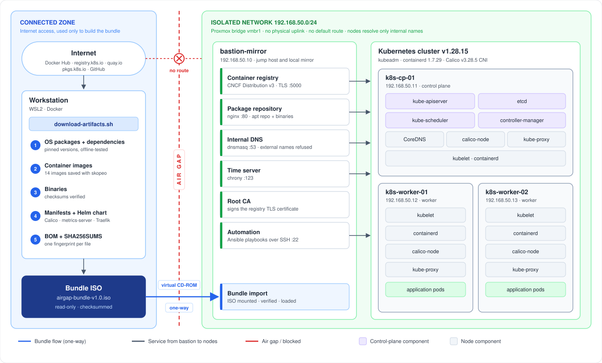

# Runbook: Air-Gapped Kubernetes Cluster

Step-by-step procedure to build the cluster from scratch, validate it, keep the mirror up to date,
and troubleshoot known problems.

**Where each command runs** is shown in brackets before each block:

| Tag | Machine |
| --- | --- |
| `[workstation]` | Connected workstation (internet, Docker) |
| `[pve]` | Proxmox VE host shell |
| `[bastion]` | bastion-mirror, 192.168.50.10 |
| `[cp-01]` | k8s-cp-01, 192.168.50.11 |
| `[workers]` | k8s-worker-01 and k8s-worker-02 |
| `[each node]` | All three Kubernetes nodes |

## Contents

1. [Architecture](#1-architecture)
2. [Prerequisites](#2-prerequisites)
3. [Lab environment](#3-lab-environment)
4. [Harvest the artifacts](#4-harvest-the-artifacts)
5. [Transfer the bundle](#5-transfer-the-bundle)
6. [Bastion setup](#6-bastion-setup)
7. [Node preparation](#7-node-preparation)
8. [Cluster bootstrap](#8-cluster-bootstrap)
9. [Security hardening](#9-security-hardening)
10. [Validation](#10-validation)
11. [Mirror update procedure](#11-mirror-update-procedure)
12. [Troubleshooting](#12-troubleshooting)

---

## 1. Architecture



| Host | Role | IP | vCPU / RAM |
| --- | --- | --- | --- |
| bastion-mirror | Registry, package repository, DNS, NTP, Root CA, Ansible | 192.168.50.10 | 2 / 2 GB |
| k8s-cp-01 | Control plane | 192.168.50.11 | 2 / 4 GB |
| k8s-worker-01 | Worker | 192.168.50.12 | 2 / 3 GB |
| k8s-worker-02 | Worker | 192.168.50.13 | 2 / 3 GB |

| Network | Range |
| --- | --- |
| Node network (Proxmox bridge `vmbr1`) | 192.168.50.0/24, no gateway |
| Pod network (Calico) | 10.244.0.0/16 |
| Service network | 10.96.0.0/12 |

---

## 2. Prerequisites

- A Proxmox VE 9.1 host with at least 16 GB RAM and a wired network connection.
- A connected workstation with `docker`, `curl`, `xorriso` and `git`. WSL2 with Docker Desktop works.
- This repository, cloned on the workstation.

---

## 3. Lab environment

### 3.1 Create the isolated network

`[pve]` In the web UI: **pve → System → Network → Create → Linux Bridge**

| Field | Value |
| --- | --- |
| Name | `vmbr1` |
| IPv4/CIDR | `192.168.50.1/24` |
| Gateway | *empty* |
| Bridge ports | *empty* (no physical NIC, so no path to the internet) |

Click **Apply Configuration**, then confirm the host does not forward packets:

```bash
sysctl net.ipv4.ip_forward     # must be 0
```

### 3.2 Build the VM template

`[pve]` Download the Ubuntu 22.04 cloud image and verify it:

```bash
cd /root
wget https://cloud-images.ubuntu.com/jammy/current/jammy-server-cloudimg-amd64.img
wget https://cloud-images.ubuntu.com/jammy/current/SHA256SUMS
sha256sum -c SHA256SUMS --ignore-missing
```

Create VM `9000` (no install media, default disk deleted), import the image as its disk, then set:

```bash
qm set 9000 --scsi0 local-lvm:0,import-from=/root/jammy-server-cloudimg-amd64.img
```

| Setting | Value | Why |
| --- | --- | --- |
| CPU | 2 cores, type `host` | |
| Network | VirtIO on `vmbr1` | Isolated from first boot |
| CloudInit drive | `local-lvm` | Per-clone hostname, IP and SSH key |
| Serial port / display | `serial0` / Serial terminal 0 | Console works without networking |
| Boot order | `scsi0` first | |
| Cloud-init user | `ubuntu` + host SSH public key | |
| DNS domain / server | `lab.home.arpa` / `192.168.50.10` | If left empty, Proxmox copies the host's internet DNS into the VMs |
| Upgrade packages | **No** | Otherwise each VM tries `apt upgrade` against the internet on first boot |

Right-click the VM → **Convert to template**.

### 3.3 Create the four VMs

`[pve]` For each row: right-click 9000 → **Clone** (Full Clone), set memory, resize the disk, and in **Cloud-Init → IP Config** set a static IP with **no gateway**.

| VM ID | Name | RAM | Disk added | IP |
| --- | --- | --- | --- | --- |
| 110 | bastion-mirror | 2048 MiB | +46 GiB | 192.168.50.10/24 |
| 111 | k8s-cp-01 | 4096 MiB | +36 GiB | 192.168.50.11/24 |
| 112 | k8s-worker-01 | 3072 MiB | +26 GiB | 192.168.50.12/24 |
| 113 | k8s-worker-02 | 3072 MiB | +26 GiB | 192.168.50.13/24 |

Start all four. Inside each VM, `ip route` must show **no** `default` line.

---

## 4. Harvest the artifacts

`[workstation]` From the repository root:

```bash
./workstation/download-artifacts.sh
```

The script runs five steps (each can also be run alone, e.g. `./workstation/download-artifacts.sh images`):

| Step | Result |
| --- | --- |
| `debs` | All OS packages with full dependencies, versions pinned, checked by an offline install test |
| `images` | 14 container images saved as tarballs |
| `binaries` | CNI plugins, crictl, Helm, registry, each verified against its published checksum |
| `manifests` | Calico, metrics-server, Traefik Helm chart |
| `package` | Repository configs added, `BOM.txt`, `SHA256SUMS`, tarball, and `airgap-bundle-v1.0.iso` |

All versions are set at the top of the script. Output goes to `~/airgap` unless `WORK` is set.

---

## 5. Transfer the bundle

1. Copy `airgap-bundle-v1.0.iso` and its `.sha256` to the Proxmox host
   (web UI: **local → ISO Images → Upload**, or **Download from URL** with the checksum filled in).
2. `[pve]` **bastion-mirror → Hardware → Add → CD/DVD Drive**, select the ISO.

The ISO is the only way data enters the isolated network. Files are never copied directly from the host to a VM.

---

## 6. Bastion setup

### 6.1 Mount, verify and extract the bundle

`[bastion]`

```bash
lsblk                                   # the bundle ISO is usually sr1 (sr0 is the cloud-init drive)
sudo mkdir -p /mnt/bundle /srv/airgap
sudo mount -o ro /dev/sr1 /mnt/bundle
cd /mnt/bundle && sha256sum -c airgap-bundle-v1.0.tar.sha256
sudo tar -xf /mnt/bundle/airgap-bundle-v1.0.tar -C /srv/airgap
cd /srv/airgap/bundle && sudo sha256sum -c SHA256SUMS --quiet   # no output = every file intact
CFG=/srv/airgap/bundle/config           # configs from this repository, used below
```

If you open a new shell later, set `CFG` again before running the commands below.

### 6.2 Use the bundle as the only package source

```bash
sudo mv /etc/apt/sources.list /etc/apt/sources.list.disabled
echo "deb [trusted=yes] file:/srv/airgap/bundle/debs ./" | sudo tee /etc/apt/sources.list.d/local.list
echo 'Acquire::Languages "none";' | sudo tee /etc/apt/apt.conf.d/99no-translations
sudo apt update
sudo apt install dnsmasq nginx chrony skopeo ansible kubectl dpkg-dev
```

### 6.3 Internal DNS

```bash
sudo cp $CFG/bastion/dnsmasq/lab.conf /etc/dnsmasq.d/lab.conf
sudo systemctl restart dnsmasq
getent hosts k8s-cp-01                  # 192.168.50.11
curl -s https://google.com; echo $?     # 6, instantly (external names are refused)
```

### 6.4 Root CA and registry certificate

Follow [`bastion/pki/README.md`](bastion/pki/README.md). It creates `/srv/airgap/pki/ca.crt`, `registry.crt` and their keys,
and makes the bastion trust the CA. The final check must print `registry.crt: OK`.

### 6.5 Container registry

```bash
cd /tmp
tar -xzf /srv/airgap/bundle/binaries/registry_3.0.0_linux_amd64.tar.gz
sudo mv registry /usr/local/bin/
sudo mkdir -p /etc/distribution
sudo cp $CFG/bastion/registry/config.yml /etc/distribution/config.yml
sudo cp $CFG/bastion/registry/registry.service /etc/systemd/system/registry.service
sudo systemctl daemon-reload
sudo systemctl enable --now registry
curl https://bastion-mirror:5000/v2/_catalog        # {"repositories":[]}
```

### 6.6 Load images and the Helm chart

```bash
bash $CFG/bastion/scripts/load-images.sh
bash $CFG/bastion/scripts/add-mirror-aliases.sh
tar -xzf /srv/airgap/bundle/binaries/helm-v3.16.4-linux-amd64.tar.gz -C /tmp
sudo mv /tmp/linux-amd64/helm /usr/local/bin/
helm push /srv/airgap/bundle/manifests/traefik-41.7.1.tgz oci://bastion-mirror:5000/charts
curl https://bastion-mirror:5000/v2/_catalog        # lists k8s/*, calico/*, nginx, busybox, charts/traefik ...
```

### 6.7 Package repository for the nodes

```bash
sudo cp -r /srv/airgap/bundle/debs /srv/airgap/repo
sudo mkdir -p /srv/airgap/files
sudo cp /srv/airgap/bundle/binaries/* /srv/airgap/pki/ca.crt /srv/airgap/files/
sudo cp $CFG/bastion/nginx/airgap /etc/nginx/sites-available/airgap
sudo rm /etc/nginx/sites-enabled/default
sudo ln -s /etc/nginx/sites-available/airgap /etc/nginx/sites-enabled/
sudo nginx -t && sudo systemctl reload nginx
curl -I http://bastion-mirror/repo/Packages.gz      # 200 OK
curl -I http://bastion-mirror/pki/ca.key            # 404 (the CA key is never served)
```

### 6.8 Time server

```bash
sudo sed -i 's/^pool/#pool/' /etc/chrony/chrony.conf
sudo cp $CFG/bastion/chrony/lab.conf /etc/chrony/conf.d/lab.conf
sudo systemctl restart chrony
chronyc tracking                                    # Stratum 10, local clock
```

### 6.9 Ansible access to the nodes

`[bastion]`

```bash
ssh-keygen -t ed25519                               # press Enter at every prompt
sudo cp ~/.ssh/id_ed25519.pub /srv/airgap/files/bastion.pub
cp -r $CFG/ansible $CFG/kubernetes ~/
```

`[each node]` (through the Proxmox console)

```bash
curl http://bastion-mirror/files/bastion.pub >> ~/.ssh/authorized_keys
```

`[bastion]`

```bash
ssh k8s-cp-01 hostname; ssh k8s-worker-01 hostname; ssh k8s-worker-02 hostname   # accept each fingerprint
cd ~/ansible && ansible k8s -m ping                                               # 3 x "pong"
```

---

## 7. Node preparation

`[bastion]`

```bash
cd ~/ansible
ansible-playbook site.yml
ansible-playbook site.yml        # second run: PLAY RECAP must show changed=0 on all nodes
```

`site.yml` runs three playbooks:

| Playbook | What it configures |
| --- | --- |
| `node-prep.yml` | apt from the bastion only, internet-calling services removed, swap off, kernel modules, sysctl, CA trust, containerd and Kubernetes packages (held), chrony client |
| `node-network.yml` | kubelet `--node-ip`, routes for the Service network and Calico's pod gateway (see [12](#12-troubleshooting)) |
| `containerd.yml` | systemd cgroups, pause image from the bastion, mirror rules for docker.io, quay.io and registry.k8s.io |

Check:

```bash
ansible k8s -a "kubeadm version -o short"                          # v1.28.15
ansible k8s -a "chronyc sources"                                   # ^* bastion-mirror
ansible k8s -a "curl -s https://bastion-mirror:5000/v2/_catalog"   # image list, no certificate error
```

`[each node]` Optional: pulls by internet name are served by the bastion:

```bash
sudo crictl pull registry.k8s.io/pause:3.9
```

---

## 8. Cluster bootstrap

### 8.1 Initialise the control plane

`[bastion]`

```bash
scp ~/kubernetes/kubeadm-config.yaml k8s-cp-01:
```

`[cp-01]`

```bash
sudo kubeadm init --config=kubeadm-config.yaml     # save the "kubeadm join ..." command it prints
mkdir -p ~/.kube
sudo cp /etc/kubernetes/admin.conf ~/.kube/config
sudo chown ubuntu: ~/.kube/config
```

### 8.2 kubectl on the bastion

`[bastion]`

```bash
mkdir -p ~/.kube
ssh k8s-cp-01 cat .kube/config > ~/.kube/config
chmod 600 ~/.kube/config
kubectl get nodes                # k8s-cp-01 NotReady until the CNI is installed
```

### 8.3 Install Calico

`[bastion]`

```bash
kubectl apply -f ~/kubernetes/calico.yaml
kubectl get pods -n kube-system -w             # wait for calico-node and coredns to be Running
kubectl get nodes                              # k8s-cp-01 Ready
```

`calico.yaml` already points at `bastion-mirror:5000/calico/*` and uses the pod network `10.244.0.0/16`.

### 8.4 Join the workers

`[workers]` Run the join command from 8.1 with `sudo`:

```bash
sudo kubeadm join 192.168.50.11:6443 --token <token> --discovery-token-ca-cert-hash sha256:<hash>
```

If the token was lost or has expired (after 24 hours), print a new command on `[cp-01]`:

```bash
kubeadm token create --print-join-command
```

### 8.5 Label the workers and check

`[bastion]`

```bash
kubectl label node k8s-worker-01 node-role.kubernetes.io/worker=
kubectl label node k8s-worker-02 node-role.kubernetes.io/worker=
kubectl get nodes -o wide                     # 3 nodes Ready, roles control-plane / worker
kubectl get pods -n kube-system -o wide       # all Running, 0 restarts
```

---

## 9. Security hardening

### 9.1 Pod Security Admission

`[bastion]`

```bash
bash ~/kubernetes/security/pod-security.sh
kubectl apply -f ~/kubernetes/tests/privileged-test.yaml   # must be REJECTED (violates baseline)
```

### 9.2 Demo app, NetworkPolicy and RBAC

`[bastion]`

```bash
kubectl apply -f ~/kubernetes/demo/airgap-demo.yaml
kubectl apply -f ~/kubernetes/demo/netpol.yaml
kubectl apply -f ~/kubernetes/demo/rbac.yaml
```

| Check | Expected |
| --- | --- |
| `curl http://k8s-worker-01:30090` | Status page: external targets BLOCKED, cluster DNS OK |
| `kubectl run root-test -n airgap-demo --image=bastion-mirror:5000/busybox:1.36 -- sleep 60` | Rejected (violates `restricted`) |
| `kubectl exec -n airgap-demo deploy/airgap-proof -- wget -q -T 3 -O - http://bastion-mirror/files/` | `download timed out` (blocked by NetworkPolicy) |
| `kubectl get pods -n airgap-demo --as=system:serviceaccount:airgap-demo:demo-viewer` | Allowed |
| `kubectl delete pod -n airgap-demo -l app=airgap-proof --as=system:serviceaccount:airgap-demo:demo-viewer` | Forbidden |
| `kubectl run blocked-test --image=redis` | `ImagePullBackOff`: images that were never shipped in cannot run |

### 9.3 Encrypt Secrets at rest

`[cp-01]`

```bash
head -c 32 /dev/urandom | base64                   # copy the key
sudo mkdir -p /etc/kubernetes/enc
sudo nano /etc/kubernetes/enc/encryption-config.yaml
```

Paste [`kubernetes/security/encryption-config.example.yaml`](kubernetes/security/encryption-config.example.yaml) with the key filled in, then:

```bash
sudo chmod 600 /etc/kubernetes/enc/encryption-config.yaml
sudo cp /etc/kubernetes/manifests/kube-apiserver.yaml ~/kube-apiserver.yaml.bak    # backup outside the manifests folder
sudo nano /etc/kubernetes/manifests/kube-apiserver.yaml
```

Add the `--encryption-provider-config` flag, the `volumeMount` and the `volume` listed in the template's comments.
kubelet restarts the API server automatically (about 60 seconds).

`[bastion]`

```bash
kubectl -n kube-system get pod kube-apiserver-k8s-cp-01 -o yaml | grep encryption   # flag present
kubectl get secrets -A -o json | kubectl replace -f -                               # re-encrypt existing Secrets
```

Back up `encryption-config.yaml` to `/srv/airgap/pki/` on the bastion, separately from any etcd backup.
If the key is lost, every Secret becomes unreadable.

---

## 10. Validation

Full commands and evidence: [`acceptance-test-report.pdf`](acceptance-test-report.pdf).

| # | Test | Where | Command | Expected |
| --- | --- | --- | --- | --- |
| 1 | Zero egress | Every node | `curl -s --connect-timeout 3 https://registry-1.docker.io; echo $?` (and `https://k8s.io`) | Instant failure (exit 6). `ip route` has no default route |
| 2 | Cluster health | bastion | `kubectl get nodes -o wide` / `kubectl get pods -n kube-system` | 1 control plane + 2 workers Ready, all pods Running, 0 restarts |
| 3 | Cluster DNS | bastion | `kubectl run test-dns --image=bastion-mirror:5000/busybox -- sleep 3600` then `kubectl exec test-dns -- nslookup kubernetes.default.svc.cluster.local` | Resolves to `10.96.0.1` |
| 4 | Multi-replica workload | bastion | `kubectl apply -f ~/kubernetes/tests/nginx-test.yaml`, then `curl -s http://<each node>:30080` repeatedly | Every node answers, responses come from all 3 pods |
| 5 | Cold restart | bastion | `cd ~/ansible && ansible k8s-cp-01,k8s-worker-01 -b -m reboot` | All nodes Ready again, pods Running, events show images "already present on machine" |

---

## 11. Mirror update procedure

Use this to ship a new application, a new image version or new packages into the isolated network.

1. `[workstation]` Edit the versions, `IMAGES` list or package lists at the top of `download-artifacts.sh`.
2. `[workstation]` Build a new bundle with a new version number:

   ```bash
   BUNDLE_VERSION=1.1 ./workstation/download-artifacts.sh
   ```

3. Transfer `airgap-bundle-v1.1.iso` to Proxmox and attach it to bastion-mirror ([section 5](#5-transfer-the-bundle)).
4. `[bastion]` Swap the old bundle for the new one, then mount, verify and extract it as in
   [6.1](#61-mount-verify-and-extract-the-bundle), replacing `v1.0` with `v1.1`:

   ```bash
   sudo umount /mnt/bundle
   sudo rm -rf /srv/airgap/bundle        # the registry, repo and files folders are kept
   ```
5. `[bastion]` Publish the new content:

   ```bash
   bash $CFG/bastion/scripts/load-images.sh                       # layers already in the registry are skipped
   sudo cp /srv/airgap/bundle/debs/*.deb /srv/airgap/repo/
   cd /srv/airgap/repo && sudo sh -c 'dpkg-scanpackages . /dev/null | gzip -9 > Packages.gz'
   sudo cp /srv/airgap/bundle/binaries/* /srv/airgap/files/
   ```

6. `[bastion]` Refresh the nodes' package lists, then deploy with images referenced as `bastion-mirror:5000/<project>/<image>:<tag>`:

   ```bash
   cd ~/ansible && ansible k8s -b -m apt -a "update_cache=yes"
   ```

### Kubernetes version upgrades

kubeadm upgrades one minor version at a time (1.28 → 1.29 → ...). For each step:

1. Ship that version's packages and images in a new bundle (set `K8S_VERSION`, `K8S_MINOR` and the kubeadm image tags in the script).
2. Back up etcd.
3. `[cp-01]` Upgrade the kubeadm package, run `sudo kubeadm upgrade plan`, then `sudo kubeadm upgrade apply v<version>`, then upgrade kubelet and kubectl.
4. `[workers]` One at a time: `kubectl drain <node> --ignore-daemonsets`, then `sudo kubeadm upgrade node`, upgrade kubelet, then `kubectl uncordon <node>`.

---

## 12. Troubleshooting

### Build environment

| Symptom | Cause | Fix |
| --- | --- | --- |
| Proxmox USB stick not bootable | Written in Rufus "ISO mode" | Re-write in **DD Image mode** |
| Proxmox installer hangs at "Waiting for /dev to be fully populated" | NVMe power-saving states never wake on this laptop (`nvme ... controller is down`, visible once `quiet` is removed from the boot line) | Add `nvme_core.default_ps_max_latency_us=0 pcie_aspm=off` to the kernel line, then make it permanent in `/etc/default/grub` and run `update-grub` |
| Proxmox "Update package database" fails | Enterprise repository enabled without a subscription | Disable the enterprise repos, add **No-Subscription** |
| Nodes take 10–20 s to fail external lookups (curl exit 28) | DNS server configured but not yet running on the bastion | Set up dnsmasq ([6.3](#63-internal-dns)). It refuses external names instantly |
| `apt update` shows `404` for `Packages.xz` or `Translation-en` | apt asks for files the local repo doesn't have | Harmless. Silenced by the `99no-translations` and `99gz-first` apt settings |
| dnsmasq log shows lookups such as `api.snapcraft.io` or `motd.ubuntu.com` | Background services trying to reach the internet | Removed by `node-prep.yml` (snapd, unattended-upgrades, apt and motd timers) |

### Registry and images

| Symptom | Cause | Fix |
| --- | --- | --- |
| `x509: certificate signed by unknown authority` | Machine doesn't trust the local CA | Install `ca.crt` in the trust store (`node-prep.yml` does this on nodes) |
| `x509: certificate is valid for bastion-mirror, not <name>` | Name used is not in the certificate's SANs | Use `bastion-mirror`, `bastion-mirror.lab.home.arpa` or `192.168.50.10` |
| `ImagePullBackOff` for an image name without `bastion-mirror:5000/` | Mirror rules keep the original path (e.g. `library/nginx`), which isn't in the registry | Use the `bastion-mirror:5000/...` name, or add an alias (`add-mirror-aliases.sh`) |
| `ImagePullBackOff` for an image that was never shipped | Not in the registry, and no internet | Expected. Ship it with the mirror update procedure |
| Acceptance test 3 image fails to pull | `bastion-mirror:5000/busybox` with no tag means `:latest` | `add-mirror-aliases.sh` adds the `latest` tag |

### Kubernetes

| Symptom | Cause | Fix |
| --- | --- | --- |
| `kubectl`: `connection to the server localhost:8080 was refused` | No kubeconfig on this machine | Copy it ([8.1](#81-initialise-the-control-plane) / [8.2](#82-kubectl-on-the-bastion)) |
| Ansible: `Could not match supplied host pattern` | Run outside `~/ansible`, so `ansible.cfg` and the inventory aren't found | `cd ~/ansible` first |
| Node `INTERNAL-IP` is `<none>`; `kubectl logs` fails with `no preferred addresses found` | No default route, so kubelet cannot detect its IP | `--node-ip` set by `node-network.yml` |
| calico-node `Init:CrashLoopBackOff`; Calico logs `dial tcp 10.96.0.1:443: connect: no route to host` | No route to the Service network | Route for `10.96.0.0/12` added by `node-network.yml` |
| calico-node Running, but CoreDNS and other pods report `no route to host` | Pods use `169.254.1.1` as their gateway. The node only answers for it (proxy ARP) if it has a route to that address | `/32` route for `169.254.1.1` added by `node-network.yml`. Delete the stuck pods to restart them |
| Pod IPs clash with node IPs | Calico's default pool `192.168.0.0/16` overlaps the node network | Pod network set to `10.244.0.0/16` in both `kubeadm-config.yaml` and `calico.yaml` |
| Pods restart randomly, nodes flap NotReady | containerd and kubelet use different cgroup drivers | `SystemdCgroup = true` (containerd) and `cgroupDriver: systemd` (kubelet) |
| API server doesn't come back after editing `kube-apiserver.yaml` | Typo or wrong indentation in the manifest | `sudo cp ~/kube-apiserver.yaml.bak /etc/kubernetes/manifests/kube-apiserver.yaml` |
